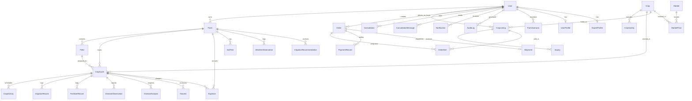

# KrishiSetu Database Architecture & ER Diagram

## 1. Overview
The KrishiSetu platform uses PostgreSQL with Prisma ORM for relational integrity, strong typing, and migration management.

## 2. Entity-Relationship Diagram (Mermaid)

## 3. Core Models & Business Roles

### A. User Management & Security
- **User:** Central identity entity with email, hashed password (`bcrypt`), phone number, role (`FARMER`, `BUYER`, `AGRICULTURE_EXPERT`, `ADMIN`), and account status (`ACTIVE`, `SUSPENDED`, `PENDING_VERIFICATION`, `DEACTIVATED`).
- **UserProfile:** Extended farmer/buyer details including avatar, bio, preferred language, state, district, pin code.
- **ExpertProfile:** Specialization, qualification, registration number, verification status, years of experience.

### B. Farm & Crop Management
- **Farm:** Farm holdings with coordinates, total acreage, soil type, primary irrigation method, and water source.
- **Field:** Sub-plots with acreage, soil condition, and individual irrigation configurations.
- **Crop & CropVariety:** Agricultural taxonomy (Marathi/Hindi names, seasonal suitability, standard duration).
- **CropCycle:** Active cultivations tracking growth stage (`PLANNING`, `SOWING`, `GROWING`, `FLOWERING`, `HARVESTING`, `COMPLETED`), acreage planted, and expected harvest dates.
- **CropActivity & Harvest:** Timeline activities (weeding, spraying, irrigation) and recorded harvest yields with quality grading.

### C. Financials & Digital Twin
- **Expense:** Categorized expenditures (seeds, fertilizer, labor, machinery, irrigation, storage) linked to farms and crop cycles.
- **FarmScenario:** What-if simulation parameters (rainfall variations, fertilizer prices, crop market price shifts) and output analytics.

### D. B2B Marketplace & Logistics
- **CropListing:** Farmer produce offers with quantity, unit (kg, quintal, tonne), asking price, quality grade, pickup district, and images.
- **Order & OrderItem:** Transactional orders with inventory reservation to prevent overselling.
- **Shipment:** Logistics records with tracking status, vehicle details, driver contacts, and delivery confirmations.

### E. Intelligence & Provenance
- **DiseaseAnalysis:** Leaf scan metadata, predicted disease classes, model confidence scores, recommended remedies, and safety warnings.
- **Market & MarketPrice:** APMC market observation data with modal, minimum, and maximum prices.
- **Scheme:** Government schemes verified with issuing authorities, eligibility criteria, and official portal URLs.
